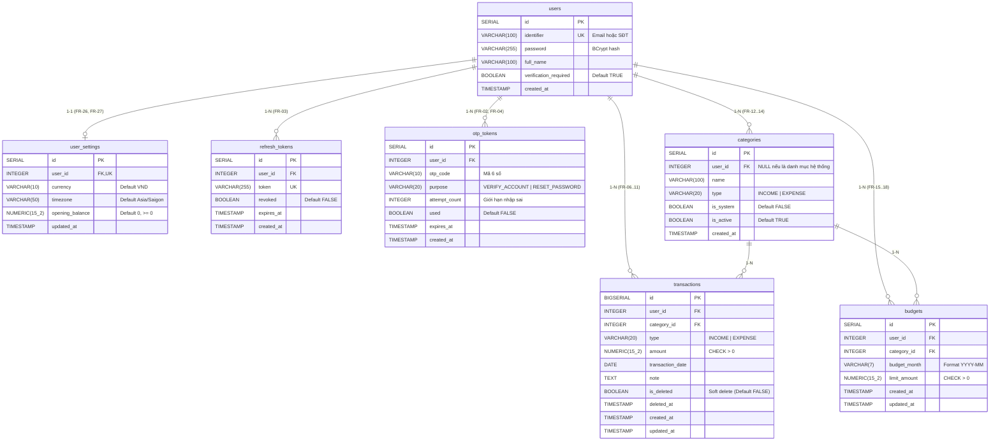

# Tài liệu Thiết kế Cơ sở Dữ liệu (Database Schema) — Financial Management

## 1. Tổng quan & Quy ước Thiết kế

- **Hệ quản trị CSDL**: PostgreSQL
- **Công cụ quản lý Migration**: Flyway (`classpath:db/migration`)
- **Chế độ Hibernate**: `spring.jpa.hibernate.ddl-auto=validate` (Mọi thay đổi bảng phải thông qua script SQL của Flyway).
- **Quy ước kiểu dữ liệu & Nghiệp vụ**:
  - **Tiền tệ (`amount`, `limit_amount`, `opening_balance`)**: Bắt buộc dùng `NUMERIC(15, 2)` để tránh sai số dấu phẩy động (`FR-08`).
  - **Cô lập dữ liệu (`NFR-02`)**: Mọi bảng dữ liệu nghiệp vụ đều gắn khóa ngoại `user_id` tham chiếu tới `users(id)`.
  - **Xóa mềm (`FR-10`)**: Bảng `transactions` dùng cột `is_deleted` (`BOOLEAN DEFAULT FALSE`) và `deleted_at` (`TIMESTAMP`), tuyệt đối không dùng lệnh `DELETE` vật lý.
  - **Danh mục mặc định & cá nhân (`FR-12`, `FR-14`)**: Bảng `categories` dùng cờ `is_system` (`TRUE` cho danh mục mặc định của hệ thống, `user_id = NULL`) và `is_active` (`FALSE` khi vô hiệu hóa danh mục đã có giao dịch).

---

## 2. Sơ đồ Quan hệ Thực thể (ERD)



---

## 3. Đặc tả Chi tiết Các Bảng (Table Definitions)

### 3.1. Bảng `users` — Người dùng (`FR-01`, `FR-02`, `FR-05`)
Khớp với Entity `com.example.backend.user.User`.

| Cột | Kiểu dữ liệu | Ràng buộc | Mô tả |
| :--- | :--- | :--- | :--- |
| `id` | `SERIAL` (`INTEGER`) | `PRIMARY KEY` | Khóa chính tự tăng |
| `identifier` | `VARCHAR(100)` | `NOT NULL`, `UNIQUE` | Email hoặc Số điện thoại (đã chuẩn hóa chữ thường) |
| `password` | `VARCHAR(255)` | `NOT NULL` | Mật khẩu đã băm bằng BCrypt (`NFR-01`) |
| `full_name` | `VARCHAR(100)` | `NOT NULL` | Họ và tên người dùng |
| `verification_required` | `BOOLEAN` | `NOT NULL DEFAULT TRUE` | `TRUE`: Chờ xác thực OTP; `FALSE`: Đã kích hoạt |
| `created_at` | `TIMESTAMP` | `NOT NULL DEFAULT CURRENT_TIMESTAMP` | Thời điểm tạo tài khoản |

---

### 3.2. Bảng `user_settings` — Thiết lập Cá nhân & Số dư đầu kỳ (`FR-26`, `FR-27`)

| Cột | Kiểu dữ liệu | Ràng buộc | Mô tả |
| :--- | :--- | :--- | :--- |
| `id` | `SERIAL` | `PRIMARY KEY` | Khóa chính |
| `user_id` | `INTEGER` | `NOT NULL`, `UNIQUE`, `FK -> users(id) ON DELETE CASCADE` | Mỗi user có 1 bản ghi thiết lập |
| `currency` | `VARCHAR(10)` | `NOT NULL DEFAULT 'VND'` | Đơn vị tiền tệ mặc định (`VND`) |
| `timezone` | `VARCHAR(50)` | `NOT NULL DEFAULT 'Asia/Saigon'` | Múi giờ hiển thị |
| `opening_balance` | `NUMERIC(15, 2)` | `NOT NULL DEFAULT 0.00`, `CHECK (opening_balance >= 0)` | Số dư đầu kỳ (`FR-27`) |
| `updated_at` | `TIMESTAMP` | `DEFAULT CURRENT_TIMESTAMP` | Thời điểm cập nhật gần nhất |

---

### 3.3. Bảng `refresh_tokens` — Quản lý Phiên Đăng nhập (`FR-03`)

| Cột | Kiểu dữ liệu | Ràng buộc | Mô tả |
| :--- | :--- | :--- | :--- |
| `id` | `SERIAL` | `PRIMARY KEY` | Khóa chính |
| `user_id` | `INTEGER` | `NOT NULL`, `FK -> users(id) ON DELETE CASCADE` | Chủ sở hữu token |
| `token` | `VARCHAR(255)` | `NOT NULL`, `UNIQUE` | Chuỗi Refresh Token |
| `revoked` | `BOOLEAN` | `NOT NULL DEFAULT FALSE` | `TRUE` khi người dùng đăng xuất (`POST /auth/logout`) |
| `expires_at` | `TIMESTAMP` | `NOT NULL` | Thời점 hết hạn |
| `created_at` | `TIMESTAMP` | `NOT NULL DEFAULT CURRENT_TIMESTAMP` | Thời điểm cấp token |

---

### 3.4. Bảng `otp_tokens` — Mã OTP Xác thực & Khôi phục Mật khẩu (`FR-02`, `FR-04`)

| Cột | Kiểu dữ liệu | Ràng buộc | Mô tả |
| :--- | :--- | :--- | :--- |
| `id` | `SERIAL` | `PRIMARY KEY` | Khóa chính |
| `user_id` | `INTEGER` | `NOT NULL`, `FK -> users(id) ON DELETE CASCADE` | Người dùng nhận OTP |
| `otp_code` | `VARCHAR(10)` | `NOT NULL` | Mã OTP 6 chữ số |
| `purpose` | `VARCHAR(20)` | `NOT NULL` | `'VERIFY_ACCOUNT'` (`FR-02`) hoặc `'RESET_PASSWORD'` (`FR-04`) |
| `attempt_count` | `INTEGER` | `NOT NULL DEFAULT 0` | Số lần nhập sai (giới hạn tối đa 5 lần) |
| `used` | `BOOLEAN` | `NOT NULL DEFAULT FALSE` | Đánh dấu mã đã sử dụng |
| `expires_at` | `TIMESTAMP` | `NOT NULL` | Thời hạn hiệu lực của OTP (ví dụ: 5 phút) |
| `created_at` | `TIMESTAMP` | `NOT NULL DEFAULT CURRENT_TIMESTAMP` | Thời điểm tạo mã |

---

### 3.5. Bảng `categories` — Danh mục Thu/Chi (`FR-12`, `FR-13`, `FR-14`)

| Cột | Kiểu dữ liệu | Ràng buộc | Mô tả |
| :--- | :--- | :--- | :--- |
| `id` | `SERIAL` | `PRIMARY KEY` | Khóa chính |
| `user_id` | `INTEGER` | `NULLABLE`, `FK -> users(id) ON DELETE CASCADE` | `NULL` nếu là danh mục hệ thống; khác `NULL` nếu là danh mục cá nhân |
| `name` | `VARCHAR(100)` | `NOT NULL` | Tên danh mục (không trùng trong cùng `user_id` và `type`) |
| `type` | `VARCHAR(20)` | `NOT NULL`, `CHECK (type IN ('INCOME', 'EXPENSE'))` | Loại danh mục: Thu (`INCOME`) hoặc Chi (`EXPENSE`) |
| `is_system` | `BOOLEAN` | `NOT NULL DEFAULT FALSE` | `TRUE`: Danh mục mặc định không cho phép user sửa/xóa (`FR-12`) |
| `is_active` | `BOOLEAN` | `NOT NULL DEFAULT TRUE` | Dùng để ẩn/vô hiệu hóa khi danh mục đã có giao dịch (`FR-14`) |
| `created_at` | `TIMESTAMP` | `NOT NULL DEFAULT CURRENT_TIMESTAMP` | Thời điểm tạo |

- **Ràng buộc duy nhất**: `UNIQUE (user_id, name, type)` (Tránh tạo trùng tên danh mục trong cùng tài khoản — `FR-13`).

---

### 3.6. Bảng `transactions` — Giao dịch Thu/Chi (`FR-06` -> `FR-11`)

| Cột | Kiểu dữ liệu | Ràng buộc | Mô tả |
| :--- | :--- | :--- | :--- |
| `id` | `BIGSERIAL` | `PRIMARY KEY` | Khóa chính |
| `user_id` | `INTEGER` | `NOT NULL`, `FK -> users(id) ON DELETE CASCADE` | Chủ sở hữu giao dịch (`NFR-02`) |
| `category_id` | `INTEGER` | `NOT NULL`, `FK -> categories(id) ON DELETE RESTRICT` | Ngăn xóa cứng danh mục đang có giao dịch (`FR-14`) |
| `type` | `VARCHAR(20)` | `NOT NULL`, `CHECK (type IN ('INCOME', 'EXPENSE'))` | Loại giao dịch: Thu hoặc Chi |
| `amount` | `NUMERIC(15, 2)` | `NOT NULL`, `CHECK (amount > 0)` | Số tiền giao dịch (`> 0` theo `FR-06`, `FR-07`, `FR-08`) |
| `transaction_date` | `DATE` | `NOT NULL` | Ngày phát sinh giao dịch |
| `note` | `TEXT` | `NULLABLE` | Ghi chú giao dịch |
| `is_deleted` | `BOOLEAN` | `NOT NULL DEFAULT FALSE` | Cờ xóa mềm (`FR-10` — không tính vào báo cáo khi `TRUE`) |
| `deleted_at` | `TIMESTAMP` | `NULLABLE` | Thời điểm xóa mềm |
| `created_at` | `TIMESTAMP` | `NOT NULL DEFAULT CURRENT_TIMESTAMP` | Thời điểm tạo |
| `updated_at` | `TIMESTAMP` | `DEFAULT CURRENT_TIMESTAMP` | Thời điểm chỉnh sửa gần nhất |

---

### 3.7. Bảng `budgets` — Ngân sách theo Danh mục & Tháng (`FR-15` -> `FR-18`)

| Cột | Kiểu dữ liệu | Ràng buộc | Mô tả |
| :--- | :--- | :--- | :--- |
| `id` | `SERIAL` | `PRIMARY KEY` | Khóa chính |
| `user_id` | `INTEGER` | `NOT NULL`, `FK -> users(id) ON DELETE CASCADE` | Chủ sở hữu ngân sách |
| `category_id` | `INTEGER` | `NOT NULL`, `FK -> categories(id) ON DELETE RESTRICT` | Danh mục áp dụng ngân sách |
| `budget_month` | `VARCHAR(7)` | `NOT NULL` | Kỳ ngân sách định dạng `'YYYY-MM'` (ví dụ `'2026-11'`) |
| `limit_amount` | `NUMERIC(15, 2)` | `NOT NULL`, `CHECK (limit_amount > 0)` | Hạn mức ngân sách trong tháng (`FR-15`) |
| `created_at` | `TIMESTAMP` | `NOT NULL DEFAULT CURRENT_TIMESTAMP` | Thời điểm tạo |
| `updated_at` | `TIMESTAMP` | `DEFAULT CURRENT_TIMESTAMP` | Thời điểm chỉnh sửa |

- **Ràng buộc duy nhất**: `UNIQUE (user_id, category_id, budget_month)` — Mỗi danh mục trong 1 tháng của 1 người dùng chỉ có tối đa 1 ngân sách (`FR-15`).

---

## 4. Chiến lược Đánh Chỉ mục — Database Indexing (`NFR-04`)

Để đảm bảo API danh sách giao dịch (`GET /api/v1/transactions`) và các API thống kê báo cáo (`GET /api/v1/reports/*`) phản hồi **dưới 2 giây với 10.000 giao dịch demo** (`NFR-04`), hệ thống sử dụng các Composite Index và Partial Index sau:

```sql
-- 1. Tối ưu lọc & phân trang giao dịch chưa xóa mềm theo người dùng và khoảng ngày (FR-11, NFR-04)
CREATE INDEX idx_transactions_user_date
    ON transactions (user_id, transaction_date DESC, id DESC)
    WHERE is_deleted = FALSE;

-- 2. Tối ưu thống kê báo cáo & tính tổng chi theo danh mục trong tháng (FR-17, FR-22)
CREATE INDEX idx_transactions_user_category_date
    ON transactions (user_id, category_id, transaction_date)
    WHERE is_deleted = FALSE;

-- 3. Tối ưu lọc giao dịch theo loại Thu/Chi (FR-11, FR-19, FR-20)
CREATE INDEX idx_transactions_user_type_date
    ON transactions (user_id, type, transaction_date)
    WHERE is_deleted = FALSE;

-- 4. Tối ưu tra cứu ngân sách theo tháng (FR-15, FR-17)
CREATE INDEX idx_budgets_user_month
    ON budgets (user_id, budget_month);
```

---

## 5. Quy ước Quản lý Flyway Migration

Các file SQL được đặt tại `backend/src/main/resources/db/migration/` theo chuẩn tên `V<version>__<description>.sql`:

| Phiên bản | Tên file | Nội dung |
| :--- | :--- | :--- |
| `V1` | `V1__init_auth_and_users.sql` | Tạo bảng `users`, `user_settings`, `refresh_tokens`, `otp_tokens` |
| `V2` | `V2__create_categories_and_seed_defaults.sql` | Tạo bảng `categories` và `INSERT` bộ danh mục mặc định (`FR-12`) |
| `V3` | `V3__create_transactions_and_budgets.sql` | Tạo bảng `transactions`, `budgets` và các Index hiệu năng (`NFR-04`) |